<a href="./README.md">日本語</a> · <a href="./README.ko.md">한국어</a> · <b>English</b>

<picture><source media="(prefers-reduced-motion: reduce)" srcset="./assets/paper/hero-still.svg"></picture> 
<picture><source media="(prefers-reduced-motion: reduce)" srcset="./assets/paper/heatmap-still.svg"></picture> 
<picture><source media="(prefers-reduced-motion: reduce)" srcset="./assets/paper/activity-still.svg"></picture> 
<a href="#rym-featured-projects"><picture><source media="(prefers-reduced-motion: reduce)" srcset="./assets/paper/world-1-still.svg"></picture></a><a href="#rym-featured-projects"><picture><source media="(prefers-reduced-motion: reduce)" srcset="./assets/paper/world-2-still.svg"></picture></a><a href="#rym-featured-projects"><picture><source media="(prefers-reduced-motion: reduce)" srcset="./assets/paper/world-3-still.svg"></picture></a> 
<h2>What I’m building</h2> 
<picture><source media="(prefers-reduced-motion: reduce)" srcset="./assets/paper/work-1-still.svg"></picture><picture><source media="(prefers-reduced-motion: reduce)" srcset="./assets/paper/work-2-still.svg"></picture><picture><source media="(prefers-reduced-motion: reduce)" srcset="./assets/paper/work-3-still.svg"></picture>

<strong>Turning manual work into systems.</strong>

TypeScript · React · SwiftUI · Python · PostgreSQL

## &nbsp;`01` &nbsp;About

I build systems that replace manual work in real-world operations.

From requirements and design to UI, APIs, databases, AI integrations, payments, infrastructure, and operations, **I take products from idea to production on my own**.
I work and communicate with clients in Japanese, Korean, and English.

 

## &nbsp;`02` &nbsp;Featured Work

<table>
<tr>
<td width="50%" valign="top">

#### AI Booking & Payment Chatbot
`Web` · `AI` · `Automation`

> An AI agent on LINE that talks with customers naturally and automates booking, payment, and calendar scheduling

`Node.js` `LangChain` `OpenAI` `PostgreSQL` `Stripe` `Google Calendar`

</td>
<td width="50%" valign="top">

#### Internal Knowledge RAG Chatbot
`Web` · `AI`

> A knowledge-search chatbot that answers grounded in internal documents and PDFs

`Next.js` `React` `Supabase` `PDF.js`

</td>
</tr>
<tr>
<td width="50%" valign="top">

#### AI Voice Call Agent
`AI` · `Voice`

> A voice dialogue system that combines speech recognition, LLMs, and speech synthesis to handle phone calls

`Python` `FastAPI` `OpenAI` `TTS` `GPU Server`

</td>
<td width="50%" valign="top">

#### Vision-Powered Business App
`Web` · `AI` · `SaaS`

> Digitizes paper-based work with OCR and canvas drawing, with billing, usage metering, role-based access, and an admin dashboard

`React` `Redux Toolkit` `Express` `MySQL` `Cloud Vision` `Fabric.js`

</td>
</tr>
<tr>
<td width="50%" valign="top">

#### Real Estate Management Platform
`Web` · `Business System`

> A unified platform for property, contract, and operations data, with document export and CSV import

`Angular` `Java` `Firebase` `REST API`

</td>
<td width="50%" valign="top">

#### Location-Based Mobile App
`Mobile` · `Full-Stack`

> A cross-platform app built around maps and location, plus its API server

`React Native` `Expo` `Fastify` `PostgreSQL`

</td>
</tr>
<tr>
<td width="50%" valign="top">

#### Habit & Health iOS App
`iOS` · `Personal`

> Tracks routines and meals, keeping users on track with widgets and Live Activities

`SwiftUI` `WidgetKit` `ActivityKit` `HealthKit`

</td>
<td width="50%" valign="top">

#### Personal Finance iOS App
`iOS` · `Personal`

> Lets partners track savings, holdings, and NISA investments together

`SwiftUI` `Swift`

</td>
</tr>
</table>

 

## &nbsp;`03` &nbsp;Strengths

**End-to-End** &nbsp;`Plan → Design → Build → Operate` 
**AI in Production** &nbsp;`LLM · RAG · OCR · Voice` 
**Multi-Platform** &nbsp;`Web · iOS · Mobile · Server` 
**Trilingual** &nbsp;`日本語 · 한국어 · English`

> I care about building systems that stay in daily use, not demos that end on a slide.

 
