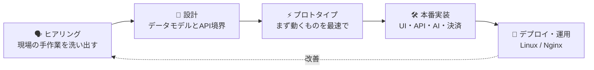

  

  

  
  
  

---

## 🛸 一言でいうと

> ### **「この業務、手作業なんですよね…」を聞いたら、動くシステムにして返すエンジニアです。**

LINE で予約を受けて、AI が会話して、決済して、カレンダーに入れる。
紙の書類を読み取って、データにして、管理画面で回す。
**企画・設計・UI・API・DB・AI・インフラ・iOS** まで、ひとりで最後まで作り切ります。

  
  
  

---

## 💪 強み

<table>
  <tr>
    <td width="33%" valign="top">
      <h3>🔁 ひとりで全工程</h3>
      ヒアリング → 設計 → 実装 → デプロイ → 運用まで一貫対応。 
      チーム間の受け渡しロスがないので、<b>とにかく速い</b>。
    </td>
    <td width="33%" valign="top">
      <h3>🤖 AI を「業務」に落とす</h3>
      デモで終わらせない。 
      LLM・OCR・自動化を<b>実際の業務フローに組み込み</b>、現場の工数を削ります。
    </td>
    <td width="33%" valign="top">
      <h3>🌏 3言語で動ける</h3>
      日本語・韓国語・英語で 
      要件定義からクライアント対応まで。<b>日韓・海外案件</b>もそのまま回せます。
    </td>
  </tr>
</table>

---

## 🔥 作ってきたもの

| | プロダクト | 課題 → 解決 |
|:-:|---|---|
| 💬 | **AI 予約チャットボット** | 電話・手入力の予約対応 → **LINE 上で AI が接客し、予約・Stripe 決済・Google カレンダー登録まで全自動** |
| 🔍 | **画像認識 × 業務アプリ** | 紙ベースの作業 → **Cloud Vision OCR と Canvas 描画でデジタル化。課金・権限管理・管理画面まで実装** |
| 🏠 | **不動産管理プラットフォーム** | 散らばった物件・契約データ → **フロント / バックエンド / モノレポで一元管理する基盤を構築** |
| 🧾 | **レシート処理ワークベンチ** | 領収書の手入力 → **読み取り・整理・確認を一画面で完結** |
| 🍙 | **Momuri** — iOS | 続かない健康管理 → **ウィジェット・Live Activity・HealthKit・AI で毎日を自動で記録** |
| 🐸 | **Kaeru** — iOS | バラバラな家計と資産 → **カップルで貯金・資産・NISA をひとつのアプリで見える化** |

---

## 🧭 開発の進め方

---

## ⚡ Tech Stack

<b>🎨 Frontend</b> 
  

<b>⚙️ Backend</b> 
  

<b>📱 Mobile ・ 🗄️ Data & Infra</b> 
  

<b>🤖 AI & Integrations</b> 
  
  
  
  
   
  
  
  
  

---

## 🎯 大事にしていること

- 🚀 **本当に使われるもの** を出荷する
- 🧩 複雑な業務を **シンプルに感じさせる**
- ⚡ プロトタイプから **動くシステム** まで最短距離で
- 🤖 「すごい」より **「現場が楽になる」** AI
- 🛠️ 忙しい現場でも迷わない UI

---

  <b>🤝 「これ自動化できない？」から一緒に始めましょう。</b>

  

